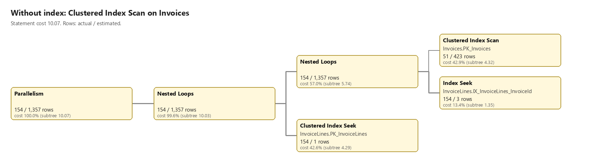
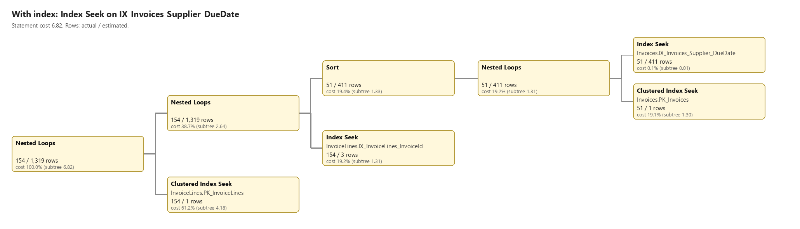

# Invoice Core

ASP.NET Core MVP / API implementing a primitive invoice management with JWT authentication, simple Razor Pages UI,
publishing events to RabbitMQ.

Part of Invoice Observer System. For the overall system architecture, see the
[Invoice Observer README](https://github.com/invoice-observer/.github/blob/main/profile/README.md).

## Key Features

1. Endpoints for invoice management.
2. JWT-based login for secure API access.
3. Razor Pages UI with cookie authentication.
4. Unit Tests for Data Layer and Postman Sequences for API testing.
5. Events are published to RabbitMQ in order to enable monitoring
6. [Postman Tests for API workflow verification](Tests/Tests.Postman/README.md)
7. [Unit Tests for core invoice services using NUnit](Tests/Tests.NUnit/README.md)

## Data Model

```csharp
public class Invoice
{
    public string Description { get; set; }
    public DateTime DueDate { get; set; }
    public string Supplier { get; set; }
    public List<InvoiceLine> Lines { get; set; }
}

public class InvoiceLine
{
    public string Description { get; set; }
    public double Price { get; set; }
    public int Quantity { get; set; }
}
```

## Technologies Used

- .NET 10.0
- Entity Framework Core tools
- Postman (for API testing)
- NUnit (for unit testing)

## REST API Endpoints

- GET /api/invoices — Returns all invoices.
- GET /api/invoices/{id} — Returns a specific invoice by ID.
- POST /api/invoices — Creates a new invoice.
- PUT /api/invoices/{id} — Updates an existing invoice.
- DELETE /api/invoices/{id} — Deletes an invoice by ID.

All invoice endpoints require valid JWT authentication.

- POST /api/auth/login — Authenticates user credentials and returns a JWT token.

## Start in Development Environment

1. Copy `demo/.env.example` to `demo/.env` if it does not exist yet, then replace the placeholders in `demo/.env`
   (`RABBITMQ_USER` must be `demo`, the `RabbitMQ:UserName` in `appsettings.Development.json`):
   ```
   if (-not (Test-Path demo/.env)) { Copy-Item demo/.env.example demo/.env }
   ```
2. Start Docker:
   ```
   docker compose -f demo/compose.yaml --env-file demo/.env up -d --wait
   ```
3. Set the User Secrets (see [Configuration and Secrets](#configuration-and-secrets)).
4. Run the app in a separate terminal:
   ```
   dotnet run --project Projects/InvoiceCoreApp --launch-profile https
   ```
5. Run the unit tests:
   ```
   dotnet test Tests/Tests.NUnit/Tests.NUnit.csproj
   ```
6. Trust the development certificate (once per machine):
   ```
   dotnet dev-certs https --trust
   ```
7. Run the Postman collection. Newman runs on Node.js, which does not trust the ASP.NET Core development certificate
   unless it reads the Windows certificate store (Node 22.15+ or 23.8+):
   ```
   $env:NODE_OPTIONS = "--use-system-ca"
   newman run Tests/Tests.Postman/Collections/InvoiceAPI.postman_collection.json -e Tests/Tests.Postman/Environments/InvoiceCore.Local.postman_environment.json --env-var auth_username=<user> --env-var auth_password=<password> --insecure
   ```

The SQL Server data lives in a named Docker volume and is deleted only by `docker compose down -v`.
The passwords in `demo/.env` take effect only when a volume is first created, so they must match the User Secrets.

## Performance Lab

Measures the paged endpoint and the `(Supplier, DueDate)` index against a seeded database.
Baseline numbers without the index are in [demo/result-interpretation.md](demo/result-interpretation.md).

1. Start SQL Server and RabbitMQ as in [Start in Development Environment](#start-in-development-environment)
   (steps 1-3).
2. Run the app once, so it creates the tables, then stop it:
   ```
   dotnet run --project Projects/InvoiceCoreApp --launch-profile https
   ```
3. Seed the database (the scripts use `sqlcmd` with the `sa` login; add `-P <password>` or set `SQLCMDPASSWORD`):
   ```
   sqlcmd -S 127.0.0.1,1433 -U sa -C -b -v InvoiceCount=500000 -i demo/seed.sql
   ```
4. Run the app again and measure:
   ```
   ./demo/measure.ps1 -BaseUrl https://localhost:7052 -UserName <user> -Password <password> -Endpoint "/api/invoices/page?supplier=Supplier 042&size=50" -Count 20
   ```
5. Create the index, then repeat step 4:
   ```
   sqlcmd -S 127.0.0.1,1433 -U sa -C -b -v Action=create -i demo/index.sql
   ```
   To return to the state without the index, drop it:
   ```
   sqlcmd -S 127.0.0.1,1433 -U sa -C -b -v Action=drop -i demo/index.sql
   ```
   Run `demo/queries.sql` in SSMS for page reads and the execution plans.

### Results

| Case                                  | Without index | With index |
|---------------------------------------|---------------|------------|
| Page reads, supplier and 30-day range | 6,787 [^1]    | 786 [^3]   |
| `GET /api/invoices/page`, median      | 11.3 ms       | 12.5 ms    |
| `GET /api/invoices/page`, min / max   | 9.8 / 15.7 ms | 9.0 / 19.1 ms |
| `GET /api/invoices`, median [^2]      | 15.6 s, 176 MB | 15.4 s, 176 MB |

[^1]: Baseline from `demo/queries.sql` query 2 (with `Include`), not from the paged endpoint.
[^2]: Measured with 3 calls after one warm-up call, not 20.
[^3]: Invoices 161 reads (index seek) + InvoiceLines 625 reads.

Execution plans (diagrams generated from the actual plans of `demo/queries.sql` query 2, not SSMS screenshots; open the `.sqlplan` files in SSMS for the originals: [without index](docs/plan-without-index.sqlplan), [with index](docs/plan-with-index.sqlplan)):





### Limits

All numbers come from one local machine, with SQL Server in Docker and the client on the same host. Each case was
measured in a single run set of 20 calls after one warm-up call. Results will differ on other hardware, data sizes
and cache states; compare page reads rather than milliseconds.

## Configuration and Secrets

No credentials are committed. The application **fails at startup** if `Auth:UserName`, `Auth:Password` or `Auth:JwtKey`
is missing or empty, or if `Auth:JwtKey` is shorter than 32 bytes (the HMAC-SHA256 minimum).
With `InvoiceService` set to `SqlServer`, it also fails if `ConnectionStrings:InvoiceDb` or `Database:Password`
is missing or empty.

| Key                     | Purpose                                         |
|-------------------------|-------------------------------------------------|
| `Auth:UserName`         | User name accepted by `POST /api/auth/login`    |
| `Auth:Password`         | Password accepted by `POST /api/auth/login`     |
| `Auth:JwtKey`           | Symmetric key that signs and validates JWTs     |
| `Database:Password`     | SQL Server password                             |
| `RabbitMQ:UserPassword` | RabbitMQ broker password (see below)            |

- Development (User Secrets, stored outside the repository):
  ```
  dotnet user-secrets set "Auth:UserName" "<user name>" --project Projects/InvoiceCoreApp
  dotnet user-secrets set "Auth:Password" "<password>" --project Projects/InvoiceCoreApp
  dotnet user-secrets set "Auth:JwtKey" "<random key>" --project Projects/InvoiceCoreApp
  dotnet user-secrets set "Database:Password" "<password>" --project Projects/InvoiceCoreApp
  ```
  Generate a random key of at least 32 bytes, e.g. in PowerShell:
  ```
  [Convert]::ToBase64String([Security.Cryptography.RandomNumberGenerator]::GetBytes(48))
  ```
- Production: environment variables `Auth__UserName`, `Auth__Password`, `Auth__JwtKey`, `Database__Password`
  (or a Key Vault / Kubernetes secret mapped to them).
- `ConnectionStrings:InvoiceDb` is set only in `appsettings.Development.json`. Outside Development, supply it as the
  environment variable `ConnectionStrings__InvoiceDb`, without a password; `Database:Password` is added at startup.

Changing `Auth:JwtKey` invalidates all previously issued tokens. Earlier revisions of this repository contained
hardcoded credentials; they are compromised and must never be reused.

### RabbitMQ

The `RabbitMQ` section of `appsettings.json` holds only non-secret values: the broker URI **without credentials**
(`amqps://host/vhost`), `UserName`, exchange, queue and routing key. The `UserPassword` is never committed;
it is supplied through the standard configuration providers and set on the `ConnectionFactory` directly,
so no URI escaping of special characters is needed and the password never appears in a string that could be logged.

- Development (User Secrets):
  ```
  dotnet user-secrets set "RabbitMQ:UserPassword" "<password>" --project Projects/InvoiceCoreApp
  ```
- Production: environment variable `RabbitMQ__UserPassword` (or a Key Vault / Kubernetes secret mapped to it).

Use `amqps://` (TLS) outside of local development and a dedicated least-privilege broker user per service.

## Testing via Postman

A Postman collection is provided for comprehensive workflow testing including:
- Authentication token acquisition
- Invoice submission
- End-to-end verification

See [Tests/Tests.Postman/README.md](Tests/Tests.Postman/README.md) for details about structure,
dependencies, and how to run the tests.

## Unit Testing

Unit test coverage for the core invoice services is provided in the NUnit test project.
See [Tests/Tests.NUnit/README.md](Tests/Tests.NUnit/README.md) for details about structure,
dependencies, and how to run the tests.
